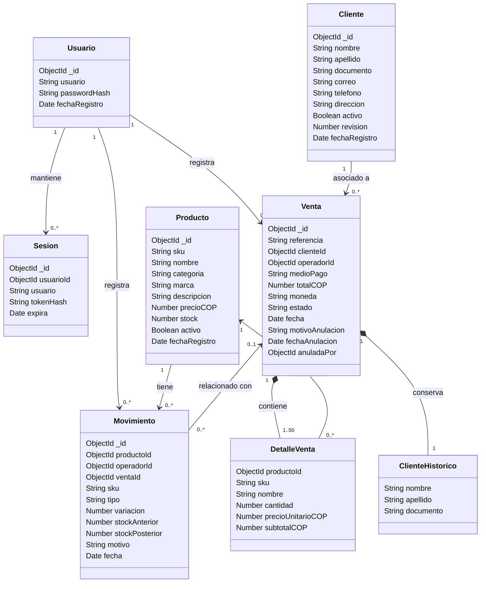
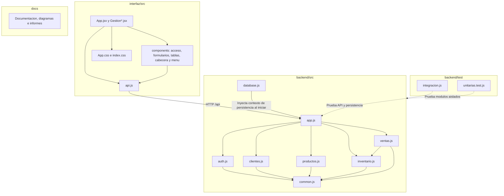
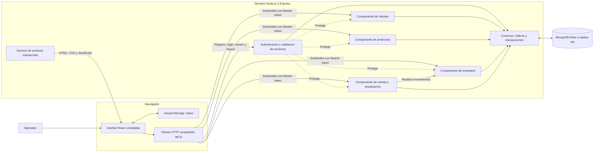
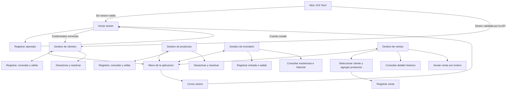

# Diagramas de JXS Tech

Evidencia: GA8-220501096-AA1-EV01.

Los diagramas describen la aplicación integrada desarrollada con React, Node.js, Express y MongoDB.

## 1. Diagrama de clases del dominio

Representa las entidades del negocio y sus relaciones.

Es un modelo conceptual: la implementación utiliza documentos de MongoDB y módulos funcionales de JavaScript. No supone que cada entidad tenga una clase JavaScript declarada.

Los detalles y los datos históricos del cliente se guardan dentro del documento de venta.

La referencia de una venta en un movimiento es opcional: las entradas y salidas manuales no necesitan una venta asociada.

Las bajas lógicas conservan las referencias históricas.

## 2. Diagrama de paquetes

Muestra la organización del código por carpetas y sus dependencias principales. Cada agrupación representa un paquete lógico de archivos.

`database.js` crea la conexión, los índices y la función de transacciones.

Los módulos reciben el contexto de persistencia por parámetro. Ventas reutiliza la operación de inventario para descontar y restituir existencias.

## 3. Diagrama de componentes

Representa los componentes que colaboran durante la ejecución.

En la versión compilada, la interfaz y la API se sirven desde el puerto 3001.

Durante el desarrollo, Vite sirve la interfaz en el puerto 5173 y redirige `/api` al backend del puerto 3001.

## 4. Mapa de navegación

Describe las pantallas y acciones disponibles para el operador.

El menú está disponible en las cuatro pantallas comerciales.

La navegación se controla mediante el estado de React. Al recargar con una sesión válida, la aplicación abre inicialmente Clientes.

El servidor exige una sesión válida para acceder a los servicios comerciales.